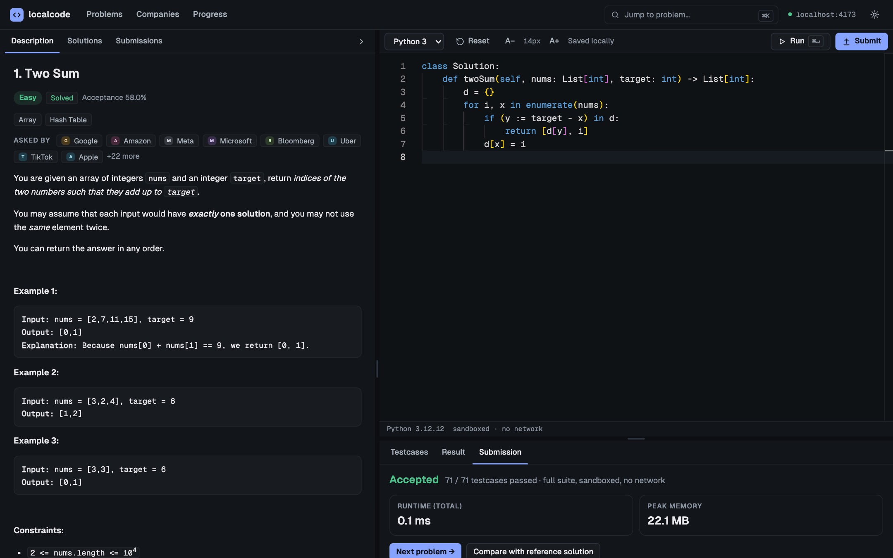
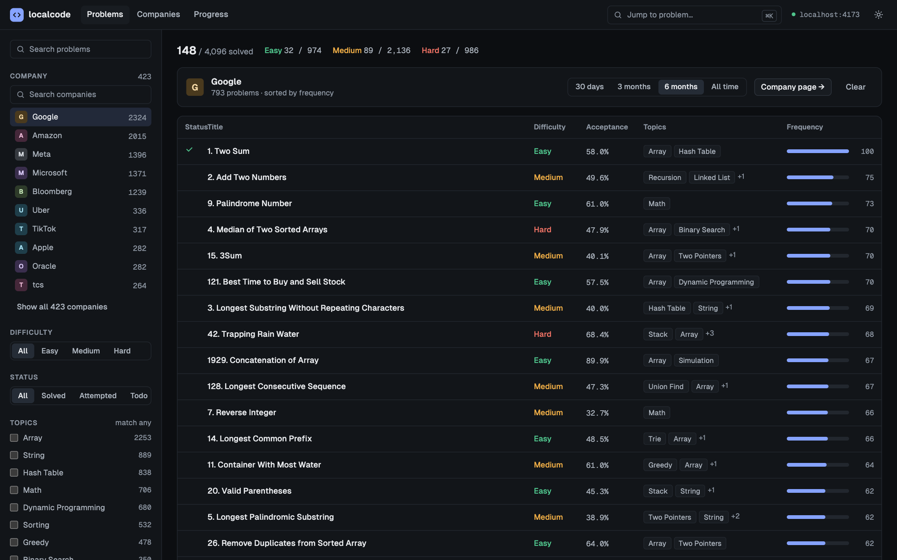
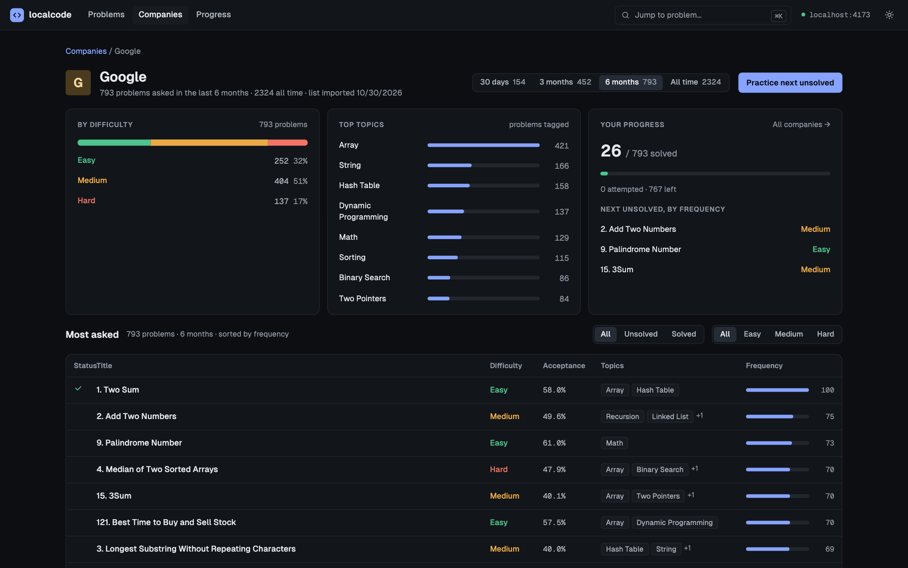
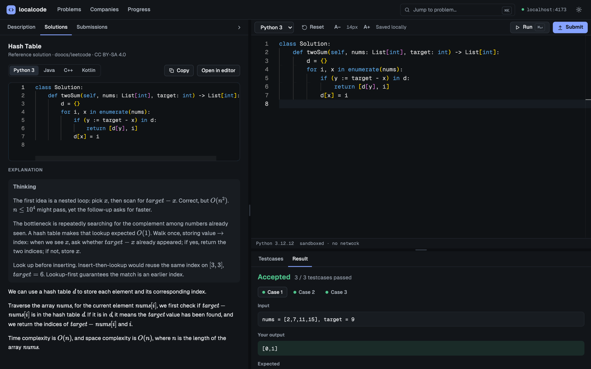
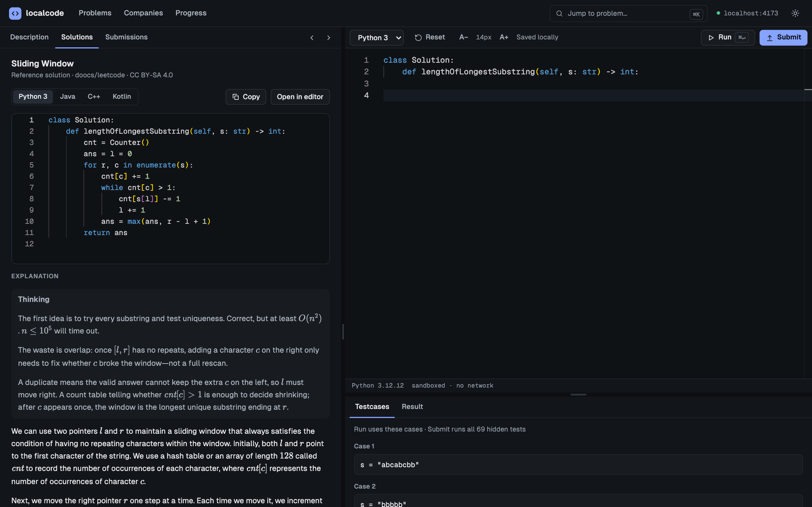
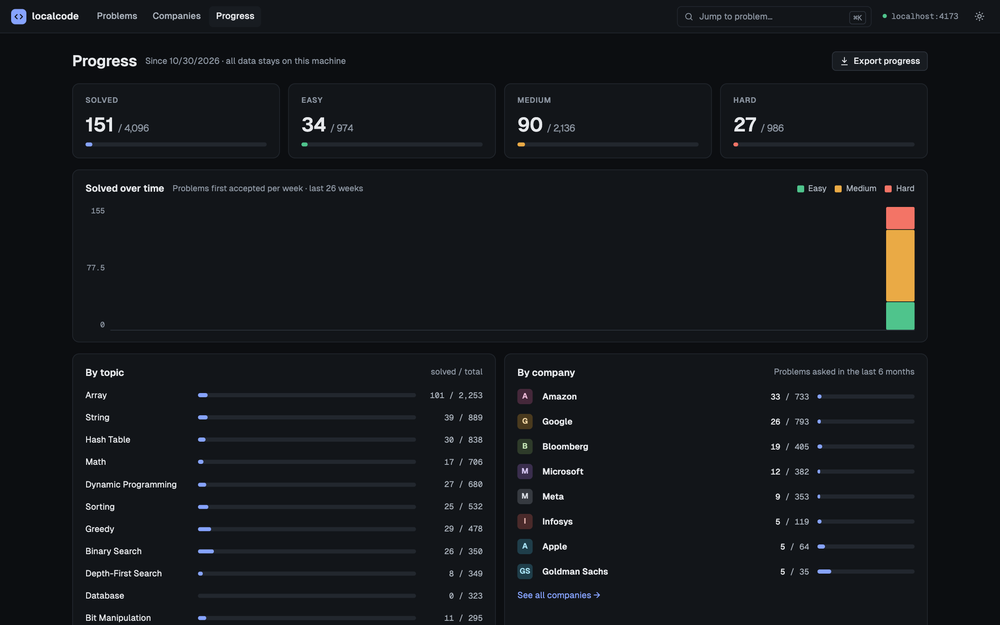
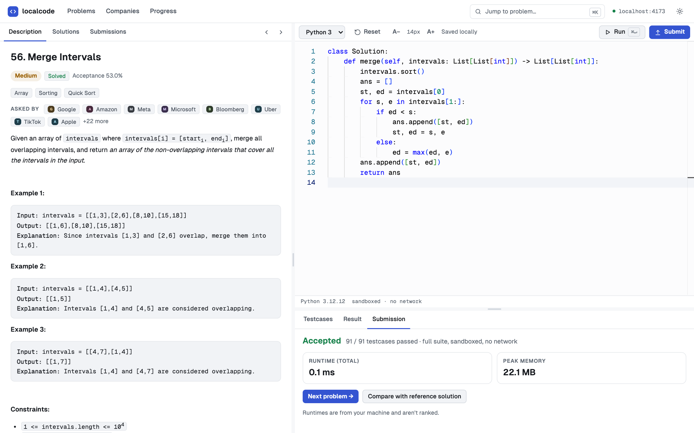
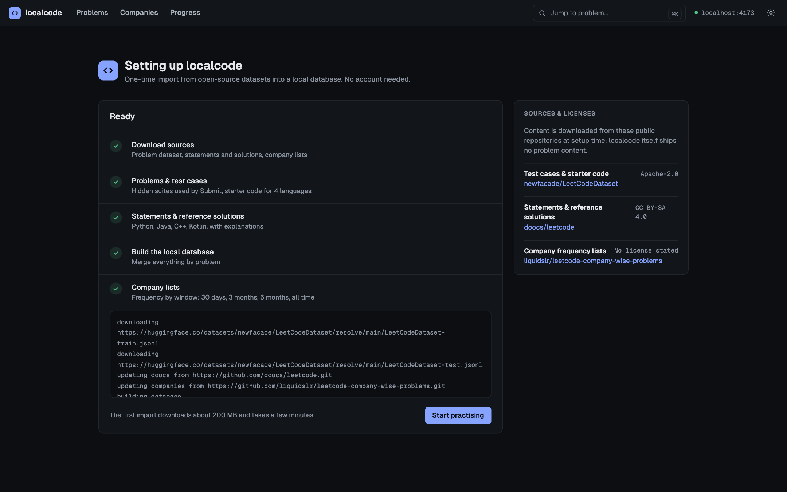
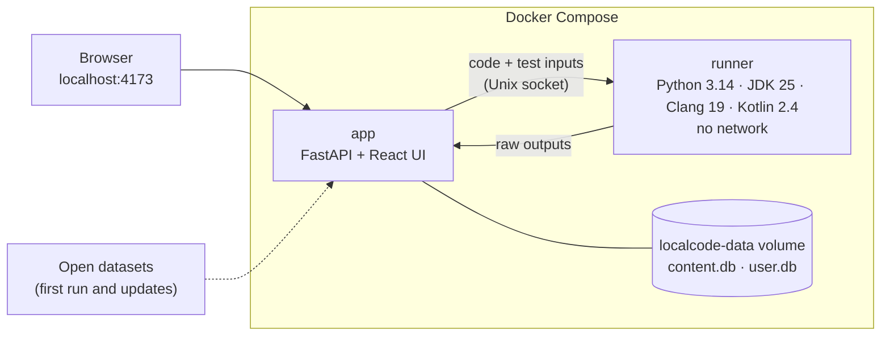
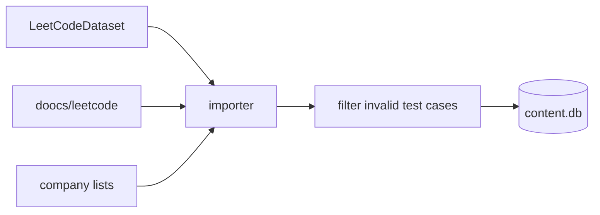

<div align="center">


# localcode

**Free, offline-friendly coding interview practice that runs entirely on your machine.**

About 4,100 problems · 2,830 judged against 273k hidden tests · company frequency lists for 423 companies · Python, Java, C++ and Kotlin

[](LICENSE)


[](CONTRIBUTING.md)



</div>

## Why localcode?

Interview prep sites lock the most useful features behind a subscription: company-tagged question lists, frequency data and full solutions. None of that needs a server. localcode puts it all on your own computer:

- **No account, no subscription, no tracking.** Your code and progress never leave your machine.
- **The same environment for everyone.** Code is judged by pinned compilers and runtimes inside Docker, so a solution that passes for you passes for anyone else.
- **Open data.** Problems, tests, solutions and company lists come from open-source projects, downloaded when you first start the app.

> localcode is an independent project. It is not affiliated with, or endorsed by, LeetCode.

## Features

<table>
  <tr>
    <td width="50%">
      
      <p><b>Company lists.</b> Pick from 423 companies and see what they asked in the last 30 days, 3 months, 6 months or all time, sorted by frequency. Filter by difficulty, status and topic.</p>
    </td>
    <td width="50%">
      
      <p><b>Company pages.</b> A company's difficulty mix and favourite topics, how much of its list you've covered, and a "practice next unsolved" button.</p>
    </td>
  </tr>
  <tr>
    <td width="50%">
      
      <p><b>Run and Submit.</b> Run checks the examples plus your own custom cases. Submit runs the full hidden suite and reports the verdict, the first failing case, runtime and memory.</p>
    </td>
    <td width="50%">
      
      <p><b>Reference solutions.</b> Several approaches per problem with explanations and complexity, in every language, with one-click "open in editor".</p>
    </td>
  </tr>
  <tr>
    <td width="50%">
      
      <p><b>Progress tracking.</b> Every problem you've solved, solved over time, coverage by topic and by company, submission history and a JSON export.</p>
    </td>
    <td width="50%">
      
      <p><b>Built for focus.</b> A Monaco editor with autosaved drafts per language, keyboard shortcuts (<kbd>⌘</kbd><kbd>↵</kbd> Run, <kbd>⌘</kbd><kbd>⇧</kbd><kbd>↵</kbd> Submit, <kbd>⌘</kbd><kbd>K</kbd> jump to a problem) and dark and light themes.</p>
    </td>
  </tr>
</table>

## Quick start

You need [Docker](https://docs.docker.com/get-docker/) with Compose v2, with at least 4 GB of memory available to it.

```bash
git clone https://github.com/RyPope/localcode.git
cd localcode
docker compose up -d --build
```

Open **http://localhost:4173**. The first launch downloads and indexes the open datasets (about 200 MB, a few minutes), and you can watch it happen:

<p align="center"></p>

Then pick a company or a problem and start solving.

| Task | Command |
|---|---|
| Stop (your data is kept) | `docker compose down` |
| Start again | `docker compose up -d` |
| Update problem data | **Progress → Refresh content**, or `make update` |
| Update localcode itself | `git pull && docker compose up -d --build` |
| Use a different port | `LOCALCODE_PORT=8080 docker compose up -d` |
| Reach it by another host name | `LOCALCODE_ALLOWED_HOSTS=localhost,mybox.lan docker compose up -d` (and change the port binding in `docker-compose.yml`) |

## How it works



- The **app** serves the UI, imports content, and judges results.
- The **runner** compiles and executes submissions. It has no network at all (the app reaches it through a Unix socket), and runs each submission as an unprivileged user with time, memory and process limits. It cleans up after every run. See [SECURITY.md](SECURITY.md) for the full model.
- **Tests are language-neutral.** Every case is stored as JSON arguments and an expected value. Small per-language harnesses turn those into real typed calls: Python through type hints, Java and Kotlin by reflection, C++ through a generated `main`. Outputs are compared in the app, never in your code.
- **Your progress lives in `user.db`**, separate from the problem data, so updating content never touches your drafts or submissions.

More detail: [docs/architecture.md](docs/architecture.md).

## Where the data comes from

localcode ships **no problem content**. On first run, your installation downloads it directly from these projects and joins them by problem slug:

| Data | Source | License |
|---|---|---|
| Test cases (about 100 per problem), Python starter code | [newfacade/LeetCodeDataset](https://huggingface.co/datasets/newfacade/LeetCodeDataset) | Apache-2.0 |
| Problem statements, reference solutions, explanations | [doocs/leetcode](https://github.com/doocs/leetcode) | CC BY-SA 4.0 |
| Company frequency lists | [liquidslr/leetcode-company-wise-problems](https://github.com/liquidslr/leetcode-company-wise-problems) | none stated |



The upstream test cases were generated by running Python solutions on synthetic inputs, and a few of them break the problems' own constraints (for example 64-bit values where a problem promises 32-bit ones). The importer removes cases the typed languages can't represent. It also applies an [exclusion list](backend/localcode/data/excluded_cases.json) of about 2,100 cases in 308 problems, produced by `make validate-cases`: it runs the Java and C++ reference solutions over every unfiltered suite with the same answer checking users get, and excludes cases the references reject, plus cases whose recorded answer fails the problem's own answer checker.

See [NOTICE.md](NOTICE.md) for attribution.

### Problems kept in this repo

The [`content/`](content/README.md) folder holds problems, test cases and solutions that are part of localcode itself. They are plain Markdown and JSON files, contributed by pull request. They're merged over the downloaded data on every import, and they can add new problems or improve existing ones. A refresh adds and updates content but never removes anything an earlier import had. See [content/README.md](content/README.md) for the format.

### If a source disappears

Each source can fall back to mirrors you control. If every source is unreachable, an update keeps your existing copy. Set any of these (comma-separated URLs, tried after the default) before starting:

| Variable | Default source |
|---|---|
| `LOCALCODE_DATASET_MIRRORS` | Hugging Face dataset files |
| `LOCALCODE_DOOCS_MIRRORS` | `github.com/doocs/leetcode` |
| `LOCALCODE_COMPANIES_MIRRORS` | `github.com/liquidslr/leetcode-company-wise-problems` |

## Your data

Everything is stored in the `localcode-data` Docker volume. To keep a copy of your progress, use **Progress → Export progress**, or back up the database file:

```bash
docker compose cp app:/data/user.db ./localcode-user-backup.db
```

`docker compose down -v` deletes the volume, **including your progress**.

## Known limitations

- **Kotlin reference solutions are sparse upstream**, so the Solutions tab shows Java for most Kotlin problems. Kotlin submissions are judged normally.
- **Problems with several valid answers** are judged by checking the answer, not by matching one expected output: 75 problems ("return any valid arrangement", course orders, Gray codes, CIDR covers, …) have a checker that validates the answer against the input, and "in any order" answers are compared ignoring order (at every level where the problem allows it). A multi-answer problem without a checker yet is still compared against one expected answer; please report it.
- **Design, SQL, shell and concurrency problems** can be read but not run.
- **C++ is compiled with Clang 19 and `-std=c++23 -O2`** but without AddressSanitizer, so some out-of-bounds bugs may go unnoticed instead of failing with a runtime error.
- **Cold-start compile times** are about 1 to 2 s for Java and C++ and about 4 s for Kotlin.

## Troubleshooting

<details>
<summary><b>The setup screen says the import failed</b></summary>

Check your internet connection and press **Retry**. If a source is down, configure a mirror (see above). `docker compose logs app` shows the details.
</details>

<details>
<summary><b>"Code runner unavailable"</b></summary>

The runner container isn't running or is restarting. `docker compose ps` should show it as running; `docker compose up -d` starts it again.
</details>

<details>
<summary><b>Port 4173 is already in use</b></summary>

Start on another port: `LOCALCODE_PORT=8080 docker compose up -d`.
</details>

<details>
<summary><b>My correct solution was rejected</b></summary>

A few upstream test cases may still be invalid. Please open a [wrong verdict report](../../issues/new?template=wrong_verdict.yml) with your code and the failing case, and we'll fix the answer checking or exclude the case.
</details>

## Contributing

Contributions are welcome, from wrong-verdict reports to new languages. Start with [CONTRIBUTING.md](CONTRIBUTING.md); for a quick start:

```bash
make setup     # Python venv + web dependencies
make up        # build and run the stack
make dev-web   # hot-reloading UI on :5173
make test      # backend, runner and web tests
make lint      # ruff, ESLint, Prettier
```

Please read the [Code of Conduct](CODE_OF_CONDUCT.md). Security issues go through [SECURITY.md](SECURITY.md), not public issues.

## Acknowledgements

localcode exists because of the people behind [LeetCodeDataset](https://github.com/newfacade/LeetCodeDataset), [doocs/leetcode](https://github.com/doocs/leetcode) and [leetcode-company-wise-problems](https://github.com/liquidslr/leetcode-company-wise-problems). It is built with [FastAPI](https://fastapi.tiangolo.com/), [React](https://react.dev/), [TanStack Query](https://tanstack.com/query), [Monaco Editor](https://microsoft.github.io/monaco-editor/), [KaTeX](https://katex.org/) and [Geist](https://vercel.com/font).

## License

[MIT](LICENSE) © 2026 Ryan Pope. Problem content downloaded at runtime is subject to its sources' licenses (see [NOTICE.md](NOTICE.md)).
